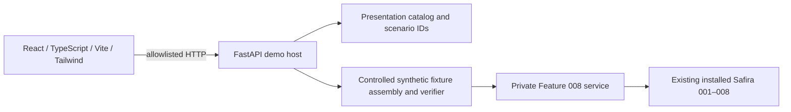

# Architecture and implementation plan

## Components and dependency direction



Framework remains at `src/safira`, unchanged. Demo host is a local research interface with a closed fixture roster, not a public patient assessment service. Frontend receives presentation objects only. Existing root `app/`, JavaScript package/lock and Vite/Vinext files are inherited and remain untouched; the demo has its own package roots. No Sites hosting or external deployment is part of this local documentation task.

## Target structure

```text
demo/
  README.md
  backend/
    pyproject.toml                 # demo-only package/dependency declarations, Phase 2
    requirements.lock             # resolved runtime + test dependencies
    app/
      __init__.py
      main.py                     # app factory and lifespan readiness
      schemas.py                  # strict request / response allowlists
      routes.py                   # four operations on four routes
      catalog.py                  # educational metadata, limitations, evidence
      execution.py                # actual private service call and safe result projection
      trace.py                    # request-local forwarding verifier observations
      fixtures/
        assembly.py               # real Safira services, synthetic recipes
        authority.py              # server-owned ledgers, no payload-selected providers
        scenarios.py               # frozen ID -> approved fixture recipe
    tests/
  frontend/
    package.json
    package-lock.json
    vite.config.ts
    src/
      app/                        # shell, routes, API client
      pages/                      # Dashboard, Explorer, Lab, Evidence
      components/                 # shared states, cards, diagrams, trace
      contracts/                  # generated presentation DTOs only
      styles/
    tests/
  docs/                           # this Phase 1 SDD
```

The API has four paths and four operations: health, pipeline, scenarios, run. Limitations/evidence are included in pipeline; no optional fifth route is necessary. Empty directories in Phase 1 are tracked by placeholders, not runtime stubs.

## Host lifecycle

1. Validate loopback settings and installed package origin against checkout. Resolve fixed dependency versions from committed locks once added.
2. Create temporary local registry and synthetic fixture authority. Build development/selection fixtures with real framework services before readiness, outside request handling. This setup is preparation, not evidence of independently evaluated performance.
3. Freeze approved artifact and fixture manifests. Qualify run IDs against unmocked service expectations in tests; startup checks integrity and required fixtures. An unavailable optional category does not force a fake result; a corrupt required published fixture prevents readiness.
4. For RUN, validate strict ID, acquire single-execution slot and select an immutable scenario recipe; isolate per-run registry/verifier views. Record no patient data, signal values or private result serialization.
5. Wrap the verifier with request-local observation forwarding, call actual service once, project status/reason and fixed lifecycle to response. Distinguish expected admission failure from internal faults. Discard request-local data after response.
6. On shutdown, close registry and remove owned temporary fixture storage. Verify resolved temporary targets before cleanup; never remove checkout directories.

Default budget: 2 KiB HTTP request body, 60-second simulation worker deadline, one active run and no queued runs (409 busy). These are demo resource limits, not scientific thresholds. Use one dedicated subprocess on Windows: it constructs all synthetic bundles during startup, signals readiness, then receives only scenario IDs over a bounded JSON pipe. It keeps artifacts frozen and uses isolated per-invocation ledger/registry views; no fitting occurs in `/run`. Parent receives only the final allowlisted payload/trace, never private objects or worker diagnostic stdout. A timeout terminates the worker, returns 504, sets health not-ready and requires explicit local restart/preparation before further runs; never silently rebuild/retrain during a POST. Thread cancellation alone cannot stop Python work. Use one application worker; reload only during development. If startup preparation is slow, show not-ready health until preparation completes; never tune scientific artifacts for speed. Worker launch uses a hidden window on Windows.

## Security configuration

- Bind backend `127.0.0.1:8000` and Vite `127.0.0.1:5173`, strict ports. Reject non-loopback binding/configuration rather than quietly widening access. Allowed Host values are exact loopback hostname/port values used in startup.
- Vite proxy forwards `/api` to loopback backend; browser uses relative `/api`. CORS is disabled by default because this is same-origin through proxy. If direct-origin dev is needed, allow only `http://127.0.0.1:5173`, no wildcard or credentials. Require that exact Origin for browser POST; missing Origin allowed only for documented local CLI/tests, with loopback Host enforcement. Reject foreign Origin even when a browser could send a simple request.
- JSON POST only, no forms/multipart; strict length and extra-field rejection. No upload/static fixture endpoints, arbitrary paths, plugin execution, deserialization via pickle/joblib, dynamic verifier selection or user code. Health reveals no paths/environment secrets.
- No external accounts, analytics or database server. Temporary framework SQLite catalog is internal, not an application patient store. No persistent simulation history. No source exception text in logs or HTTP responses; fixed failure codes and random request IDs only.
- No authentication product is proposed for this loopback MVP. This configuration does not support LAN/internet use; any such expansion needs separately scoped host security work.

## Dependencies and reproducibility

Keep framework `pyproject.toml` unchanged. Demo backend installs current checkout editable plus a separate `safira-demo` package from `demo/backend`. Plan FastAPI, Pydantic v2, Uvicorn, pytest and HTTPX; select compatible exact versions in Batch A and commit full lock with hashes. Frontend uses React, TypeScript, Vite and Tailwind with exact versions plus Vitest/Testing Library/Playwright in its independent package lock. Do not reuse root Vinext scripts or assert unverified current package versions. Resolve supported dependency/Node versions from official package requirements during implementation, record them, then use `npm ci`. Preserve sklearn 1.7.1.

Phase 1 installed only framework plus existing runtime-test dependencies, captured in `phase1-environment.txt`. This is a reproducibility snapshot, not the future backend lock. Full clean-environment install and Windows browser rehearsal are Batch D gates.

## Integration proof and boundaries

Tests must fail if installed Safira/service is unavailable, if framework fitting occurs inside the service boundary, or if returned status is replaced with scenario metadata. Compare assembled artifacts to existing fixture workflows in tests, not by copying numeric algorithms. Verify artifact digests before/after runs and enforce no protected-target reads with raising sentinel properties as existing audits do. Assertions against numeric private intermediates may remain inside tests only, never API responses/logs.

Detailed dependency order is [tasks.md](tasks.md). No implementation of backend, frontend or Feature 009 is authorized in Phase 1.
